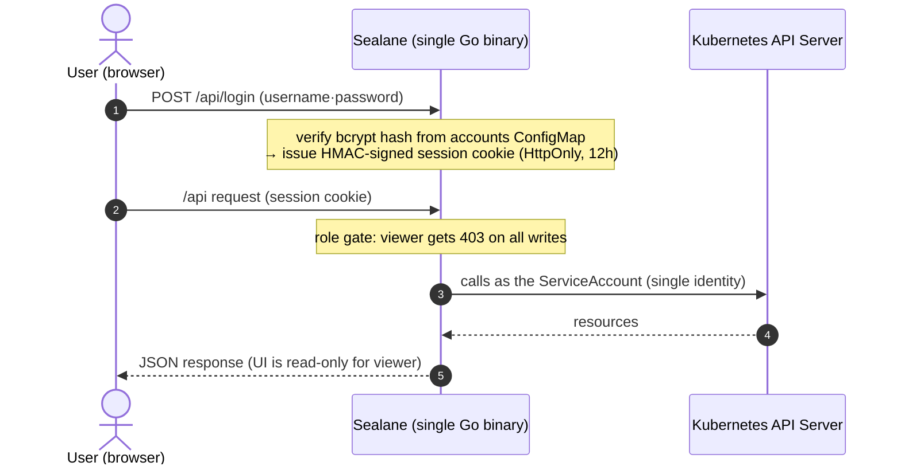

# Sealane

**English** | [Korean](README.ko.md)


> Sealane is a third-party tool for Istio. It is not an official Istio or CNCF project and is not affiliated with or endorsed by them.

**Sealane is a routing console for Istio and Gateway API.** It is a single-binary web UI that lets you browse, create and edit `VirtualService`, `HTTPRoute`, `DestinationRule`, `Gateway`, `AuthorizationPolicy` and the rest of the Istio and Gateway API resources through schema-driven forms or YAML, with dry-run validation, diff preview and role-based accounts, and no CRDs or operators installed in your cluster.

```bash
helm install sealane oci://ghcr.io/wonjune95/charts/sealane --version 0.8.0 -n sealane --create-namespace
kubectl -n sealane port-forward svc/sealane 8080:8080   # → http://localhost:8080, log in as admin / admin
```


> Upgrading from **Istio Dashboard** (the project's previous name)? See [docs/upgrading.md](docs/upgrading.md) — your accounts and clusters carry over.

---

## TL;DR

- **Local accounts and roles** — users live in one ConfigMap (`user: "role:bcryptHash"`); login issues an HMAC-signed session cookie. Cluster calls run as the pod's ServiceAccount; the app role (`admin` / `editor` / `viewer`) decides who may change what. A first boot creates `admin`/`admin` and forces a password change.
- **Writes are guarded** — every write is dry-run validated, previewed as a `kubectl diff`-style change, and checked against `resourceVersion` so a 409 shows *your copy vs the server's*. High-risk kinds require typing the resource name. Every change made through the UI lands in the change history with the account name.
- **Stateless, air-gapped** — React is embedded in the Go binary; sessions are signed cookies, so N replicas scale horizontally and nothing is fetched from the internet at runtime.
- **Generic resource engine** — dynamic-client based; 12 Istio kinds and 7 Gateway API kinds share one CRUD pipeline, and only CRDs present in the cluster are shown.
- **Traffic flow map** — draws ingress/egress paths from routing config alone; broken paths (missing service, zero endpoints) show as red edges.
- **Request console** — *Check route* computes which rule a request would hit without sending traffic; *Send* (opt-in, admin only) runs the request from inside a pod you pick so you see the real sidecar behavior.
- **Multi-cluster** — paste a kubeconfig to register a remote cluster; credentials stay in the host cluster's Secret and nothing is installed on targets.
- **English UI with a Korean locale** — switch from the header.

---

## Why this exists

A single typo in a `VirtualService` can take down an entire service. Yet the usual options are raw YAML with `kubectl apply` (no protection against human error) or observability-focused tools like Kiali (weak at editing configuration). This project fills the gap in between: **a console for safely editing configuration**.

One constraint drove the design — **"it must work just by deploying it."** No extra CRDs or operators on the cluster; it reads and renders existing resources the moment it connects. Kubernetes is the single source of truth and Sealane itself holds no state.

---

## Architecture & security model



- **Local accounts = ConfigMap** — one key in the `sealane-accounts` ConfigMap is one account (`username: "role:bcryptHash"`). Stored in the cluster (etcd), not the pod, so **accounts survive restarts and redeploys**; Helm doesn't manage this CM so upgrades keep it. Changes propagate through the mounted volume **within ~1 minute, no restart**.
- **Account management UI** — admins can add accounts, change roles/passwords, and delete accounts from the settings page (`GET/PUT/DELETE /api/accounts`; the server patches the CM). Self-deletion, self role-change, and deleting the `admin` account are blocked to prevent lockout. `kubectl edit` works too.
- **Initial admin + forced change** — if no admin account exists at boot, `admin`/`admin` is created. Logging in with the initial password **locks the UI to a password-change screen** until you change it.
- **Three roles** — `viewer` (read-only) · `editor` (can write) · `admin`. The server gates every mutating request by role (403) and the UI disables buttons using the same information.
- **Change your own password** — user chip in the header → settings page, after verifying the current password (viewers included). The server patches only your own CM key.
- **Multi-cluster** — remote-cluster kubeconfigs are stored in the `sealane-clusters` Secret (key = cluster name). Register/delete is admin-only (`PUT/DELETE /api/clusters/{name}`, with a connectivity test on register), and the settings page shows each cluster's **connection status and version**. Every API takes a `?cluster=` parameter (default `local`). The CRD catalog and schema caches are per-cluster, so clusters with different CRDs installed are handled safely.
- **Sessions are signed cookies** — no server store, stateless HA intact. Without `SESSION_SECRET` a random per-boot key is used (restart = re-login).
- **Hardening** — security headers including CSP (`default-src 'self'`), HttpOnly cookies, distroless non-root image, readOnlyRootFilesystem.
- **Air-gapped** — the frontend bundle is inlined into the binary. Zero runtime external dependencies.

---

## Key features

### Generic resource engine
A single CRUD path (`/api/resources/{type}`) built on the dynamic client (unstructured) covers everything below. Only CRDs actually installed on the cluster are exposed (`/api/capabilities`, `/api/resourceTypes`).

| Category | Kinds |
|---|---|
| **Traffic** (Istio) | VirtualService · DestinationRule · Gateway · ServiceEntry · Sidecar · WorkloadEntry · WorkloadGroup · EnvoyFilter |
| **Security** (Istio) | AuthorizationPolicy · PeerAuthentication · RequestAuthentication |
| **Telemetry** (Istio) | Telemetry |
| **Gateway API** | GatewayClass · Gateway · HTTPRoute · GRPCRoute · TCPRoute · TLSRoute · ReferenceGrant |

### Multiple write safeguards
1. **Dry-run first** — `DryRun=All` catches admission-webhook and schema errors before saving.
2. **Diff preview** — line-level diff between the current and proposed object, `kubectl diff`-style.
3. **409 conflict control** — on `resourceVersion` mismatch, never blindly overwrite; show *my edit vs server latest* and let the user decide.
4. **High-risk confirmation** — kinds with a large blast radius require typing the resource name to delete/update.

### Traffic flow map
Draws the traffic path purely from routing configuration — no metrics dependency, so it works on any cluster immediately.

- **Ingress** — External → Gateway → Route (hosts) → Service (endpoint counts). Backends that don't exist or have zero endpoints get red edges + warning pills, so dead-end configs are caught at a glance.
- **Egress** — Mesh → egress Gateway → external hosts; ServiceEntries not referenced by any route are shown as direct egress paths. External backends get a badge with the ServiceEntry that covers them (wildcard host matching included).
- **Navigation** — switch between ingress and egress, search by name/host/kind, filter by namespace or problem paths. Matching nodes retain their upstream and downstream connections. Missing gateway references appear as warning nodes.
- **Interaction** — select a node with a click or keyboard to highlight its paths. The details panel shows its status, hosts, port and resource link. Mouse drag, zoom, fit and layout reset are available. On mobile, horizontal scrolling stays inside the graph.
- **Refresh** — configuration refreshes every 30 seconds, with a manual refresh button. Failed queries show an error and retry action. Animated connections do not represent actual traffic volume or latency.


### Request console — route check (simulator)
Compose a request Postman-style (method, URL, headers, body) and verify it two ways. **Route check** computes which rule the request matches and where it goes — **without sending any request**. No traffic, no side effects, and no extra permissions (viewers can use it).

- **Shows the evaluation** — not just the winning rule, but **every rule that did not match and why** (which condition failed). That answers "why didn't it take this rule?" directly.
- **Verifies the destination** — service existence and endpoint count, plus whether the `subset` is actually defined in a DestinationRule (a typo there silently blackholes traffic).
- **Models precedence correctly** — Istio takes the first match in declaration order; Gateway API follows the spec (path type → path length → method → header count). PathPrefix segment boundaries are respected (`/api` does not match `/apifoo`).


### Send a real request (opt-in)
The same request can be **sent from inside a pod you pick under Source**. It goes through that pod's sidecar, so routing, authorization and mTLS are exercised for real — not "this is how it should route" but "this is how it routed".

- **Responses read in Istio terms** — `403` + `RBAC: access denied` → denied by an AuthorizationPolicy; `503` + `upstream connect error` → mTLS mismatch or no healthy endpoint; presence of Envoy headers → whether the sidecar was actually traversed. Upstream service time (`x-envoy-upstream-service-time`) is shown alongside.
- **Three locks** — (1) Helm opt-in (`requestTester.enabled=true`, off by default), (2) admin only, (3) argv built without a shell, plus input validation (scheme, method, header newlines) and timeout/response-size caps. Every test request is audit-logged with user, source pod and target URL.
- **The cost of enabling it** — the ServiceAccount gains `pods` read and `pods/exec` create, which is effectively arbitrary command execution in any pod. That's why it ships off. If the target container has no `curl` (distroless), the UI says so.

To try it: `kubectl apply -f examples/demo-mesh.yaml` brings up sidecar-injected `echo` v1/v2, a curl client and an ingress Gateway route for the flow map, so you can watch the `x-user: beta` canary split both ways (clean up with `kubectl delete namespace sealane-demo`).


### Role-aware UI + change history
- The UI checks the logged-in account's role up front: for viewers, forms and apply/delete buttons turn **read-only**. The server enforces the same rule (403), so the UI can't be bypassed.
- The home page's **change history** panel records create/update/delete operations made through Sealane with account and timestamp (in-memory, last 200 — resets on restart; the structured audit log is the durable record). Home cards also show the actual istiod control-plane version (e.g. `1.30.2`).

### Schema-driven forms + YAML dual editing
- `react-jsonschema-form` reads the CRD OpenAPI schema and generates input forms — safe editing without knowing YAML.
- **Required/recommended markers** — every field gets a `*` (required) · `(recommended)` · `(optional)` badge. On top of the CRD schema's `required`, a curated list compensates for Istio schemas not declaring top-level requireds (VS `hosts`, DR `host`, Gateway `selector`/`servers`, SE `hosts`/`ports`).
- **Reference-resolving forms** — `host`/`backendRefs` suggest Services, `subset` suggests DestinationRule subsets, `gateways`/`parentRefs` suggest Gateways from the live cluster, with existence badges (✓/⚠) and jump links. Free-text is preserved so external hosts and cross-namespace references still work.
- Form ↔ YAML stay in sync. If the object uses advanced fields the form can't express, the form tab locks with a "YAML only" notice → no field loss.

### UI
**Workspace navigation** — the sidebar always shows the current cluster, followed by the main screens (cluster overview, all resources, traffic flow, request console) and the installed resource kinds grouped by category. A **single search box** narrows a long list of kinds, and each one carries its count.

- **Light/dark** — the theme syncs across tabs and carries into the YAML editor. The accent color lives in one CSS variable (`--accent`), so a one-line change reskins the app.
- **Responsive** — no horizontal scrolling down to 320px; navigation collapses into a drawer on narrow screens.
- **Accessibility** — confirm dialogs trap keyboard focus and close on Escape. High-risk resources still require typing the name to proceed.
- The YAML editor shows indent guides so indentation mistakes are visible.


---

## Quick start (Kubernetes)

If you just want the prebuilt image, the OCI one-liner at the [top](#sealane) is all you need; the steps below are for building and installing from a clone.

Running in-cluster is the default. You only need Docker and Helm (the image build is multi-stage — no local Go/Node required).

### 1) Image
Every release tag (`v*`) publishes an image via GitHub Actions — use it directly:
```bash
# prebuilt image (recommended)
ghcr.io/wonjune95/sealane:latest
```
Or build your own:
```bash
docker build -t <registry>/sealane:<tag> .
docker push <registry>/sealane:<tag>
```

### 2) Helm install
```bash
helm install sealane ./charts/sealane -n sealane --create-namespace \
  --set image.repository=<registry>/sealane --set image.tag=<tag>
```
Key values: `image.*`, `imagePullSecrets` (private registries), `replicaCount` (stateless — scale for HA), `accountsConfigMap`, `clustersSecret`, `requestTester.enabled` (real request tester — off by default; enabling it grants `pods/exec`). The pod runs distroless non-root (uid 65532) with readOnlyRootFilesystem.

### 3) Expose — attach an HTTPRoute to your cluster's Gateway
```bash
# adjust parentRefs/hostname first
kubectl apply -f examples/httproute.yaml
```

### 4) Log in
On first boot the initial account **`admin` / `admin`** is created. Logging in takes you straight to a password-change screen — you must change it before going any further.


### 5) Add accounts
As admin, use **settings → account management** to add accounts and change roles/passwords in the UI (self-delete, self role-change, and deleting `admin` are blocked). The store is still a ConfigMap, so kubectl works too:
```bash
go run ./hack/bcrypt-hash.go 'password'                      # generate bcrypt hash
# (without Go) htpasswd -bnBC 10 "" 'password' | tr -d ':\n'
kubectl -n sealane edit configmap sealane-accounts
# add to data:  username: "role:hash"   (role: admin | editor | viewer)
```
No restart needed — mounted-volume sync applies it within ~1 minute. See `examples/accounts-configmap.yaml`.

### 6) Register more clusters (optional)
To manage multiple clusters from one Sealane install, go to **settings → cluster management** as admin and paste the target cluster's kubeconfig with a name. A connectivity test runs on registration, and the header dropdown switches clusters. Nothing is installed on target clusters; credentials live only in the `sealane-clusters` Secret next to Sealane.


---

## Configuration

| Flag / env | Default | Description |
|---|---|---|
| `--addr` | `:8080` | listen address |
| `--dev` | `false` | skip login + use local kubeconfig (**refuses to boot in-cluster**) |
| `--kubeconfig` | (default loading rules) | dev-only kubeconfig path |
| `ACCOUNTS_DIR` | `/etc/sealane/accounts` | accounts ConfigMap mount path |
| `ACCOUNTS_CONFIGMAP` / `POD_NAMESPACE` | (set by Helm) | CM that password changes / initial-admin creation patch |
| `ISTIO_NAMESPACE` | `istio-system` (set by the chart from `istioNamespace`) | namespace where istiod runs; used to show the control-plane version on the home page |
| `SESSION_SECRET` | (none) | session cookie signing key; empty = random per boot (restart = re-login) |
| `REQUEST_TESTER` | (set by Helm) | `true` enables the in-pod request tester (needs pods/exec, admin only) |
| `CLUSTERS_SECRET` / `POD_NAMESPACE` | (set by Helm) | multi-cluster: Secret holding remote kubeconfigs (empty = local only) |

Probes: `/healthz` (live) · `/readyz` (ready) · `/metrics` (Prometheus). Logs are structured `slog` JSON (request log + write audit log).

---

## Design decisions

### Why a generic engine instead of per-kind structures
The initial design had dedicated providers for `HTTPRoute`/`VirtualService`. But Istio + Gateway API span ~20 kinds with evolving CRD versions; per-kind models scale maintenance linearly and break on version changes. → Switched to **dynamic client + auto-generated forms from CRD OpenAPI schemas**: adding a kind is one registry line, and schema changes are absorbed automatically. Curated forms can still be layered on for a few kinds that need them.

### Why app-local accounts instead of token passthrough
The first implementation passed the user's Kubernetes bearer token through, authorizing with cluster RBAC — accurate, but issuing/delivering/renewing tokens per user was operationally painful and login UX was poor. → Switched to **app-local accounts (ConfigMap) + roles**, with all cluster operations under a single SA identity. The downside (K8s audit logs show the SA, not the user) is offset by Sealane's own change history recording account names. If per-user K8s RBAC parity becomes necessary, this can be extended with Impersonation.

### Why no real-time SSE streams
The design stage considered per-user watch → SSE live sync. But keeping the server stateless for HA means opening a watch per connection — replicas × concurrent users watch connections against the API server. For an internal ops tool (tens of concurrent users, low change frequency) that cost wasn't justified. → Kept the server stateless and converged on the **in-memory change history** (30s refresh) plus manual refresh. *A deliberate trade: "unbreakable stateless HA" over "nice-to-have real-time".*

### Why the `--dev` boot guardrail
`--dev` skips login and uses a local kubeconfig — convenient locally, an auth bypass if it ever runs in production. So when `KUBERNETES_SERVICE_HOST` (injected into every pod) is detected together with `--dev`, the process **exits immediately** (inducing CrashLoopBackOff). Accidentally shipping dev mode to a cluster is structurally impossible.

---

## Project layout

```
sealane/
├─ cmd/server/main.go          # entrypoint: ServeMux, probes/metrics, graceful shutdown
├─ internal/
│  ├─ api/                     # JSON handlers (resources CRUD, login/accounts/clusters, capabilities,
│  │                           #  flow map, route simulator, request tester, change history)
│  ├─ auth/                    # local accounts (bcrypt) + HMAC sessions
│  ├─ k8s/                     # per-cluster client factory, kind registry, discovery, lookups, pod exec
│  ├─ assets/                  # built React (dist) embed + SPA fallback
│  └─ observability/           # slog logging, Prometheus metrics
├─ web/                        # React 18 + TS + Vite + Tailwind + rjsf + CodeMirror
│  ├─ src/i18n/                # en.json · ko.json (UI strings)
│  └─ tests/                   # browser regression checks (cluster selection and traffic flow)
├─ hack/
│  ├─ bcrypt-hash.go           # password hash helper
│  └─ check-i18n.sh            # CI guard: no Korean outside locale files, en/ko keys match
├─ charts/sealane/             # Helm chart: deployment / service / rbac / values
├─ examples/                   # accounts-configmap.yaml · httproute.yaml · demo-mesh.yaml
├─ docs/                       # upgrading.md, img/ (screenshots)
├─ .github/workflows/          # ci.yml (test/build) · release.yml (tag → ghcr.io image + chart)
├─ Dockerfile  go.mod
```

## Tech stack
- **Backend** — Go 1.26, `net/http` (1.22 ServeMux), `client-go` dynamic client, `istio.io/client-go`, `sigs.k8s.io/gateway-api`
- **Frontend** — React 18 · TypeScript · Vite · Tailwind · TanStack Query · React Router · react-jsonschema-form · CodeMirror
- **Deploy** — multi-stage Docker (distroless, non-root) · Helm

## Development

For local development/testing only (not needed for deployment). Requirements: Go 1.26+, Node.js 20+, a kubectl context (kind/docker-desktop is fine).

```bash
go run ./cmd/server --dev          # backend :8080, local kubeconfig (refuses to boot in-cluster)
cd web && npm run dev              # frontend HMR: Vite :5173 → /api proxy → :8080

go test ./internal/...             # unit tests (auth boundaries, registry cache, write guards, audit, flow map)
go vet ./cmd/... ./internal/...
./hack/check-i18n.sh               # no Korean outside locale files, en/ko keys match
helm lint charts/sealane
cd web && npm run lint                     # ESLint
cd web && npm run test:cluster-selection   # cluster selection recovery
cd web && npm run test:flow-map            # path filtering, drag and responsive UI

# single binary without a container
cd web && npm ci && npm run build  # frontend build → internal/assets/dist
CGO_ENABLED=0 go build -ldflags="-s -w" -o bin/server ./cmd/server
```

Browser tests need a running frontend (`SEALANE_TEST_URL`, e.g. `http://localhost:5173`) and Playwright Chromium. They replace API responses with fixtures. See [web/tests/README.md](web/tests/README.md) for setup and options.

## Permission model

Permissions come in two separate layers — cluster permissions and user permissions:

| Layer | Owner | Scope |
|---|---|---|
| Cluster (K8s RBAC) | pod ServiceAccount | CRUD on managed CRDs (`*.networking.istio.io`, `security/telemetry.istio.io`, `*.gateway.networking.k8s.io`) + read namespaces/services/endpoints + patch accounts CM / clusters Secret. Configured by Helm. |
| User (app roles) | accounts ConfigMap | `admin` = write + account/cluster management, `editor` = write, `viewer` = read-only. The server gates every mutating request (403). |

Account management: admins use the **account management UI** on the settings page, or edit the `sealane-accounts` ConfigMap directly (add key = add account, edit role string = change role, delete key = delete account). Everyone changes their own password on the settings page.

## Appendix — exposing Sealane

The install one-liner is at the [top](#sealane); to install from source, `git clone` then `helm install sealane ./charts/sealane -n sealane --create-namespace` (see quick start step 1 for image builds). Expose it to match your cluster:

```bash
# with Gateway API — adjust parentRefs/hostname first
kubectl apply -f examples/httproute.yaml

# with an Ingress controller — create an Ingress backed by service sealane:8080
```

After installing: ① change the admin password (forced at first login) ② add accounts (settings → account management) ③ for multi-cluster, register kubeconfigs (settings → cluster management). Uninstall with `helm uninstall sealane -n sealane` (the accounts ConfigMap and clusters Secret survive — delete them too for a full cleanup).

## License

[MIT](LICENSE)
