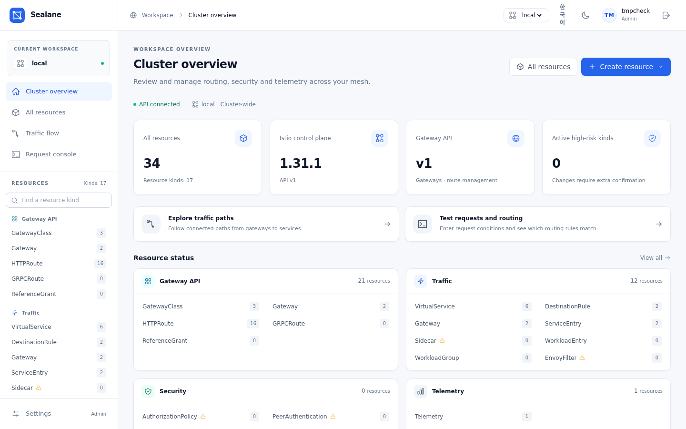
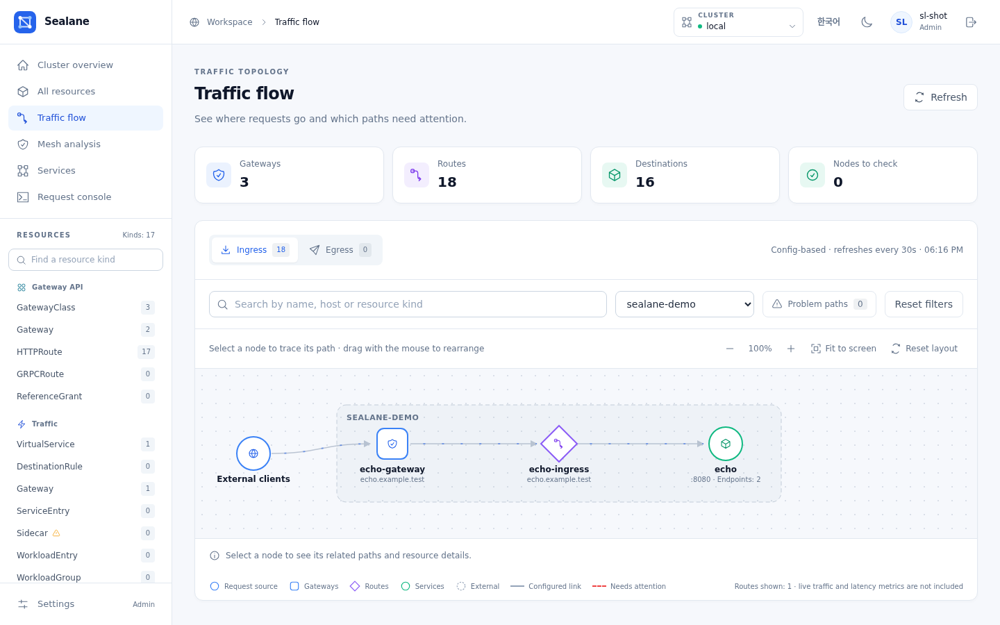
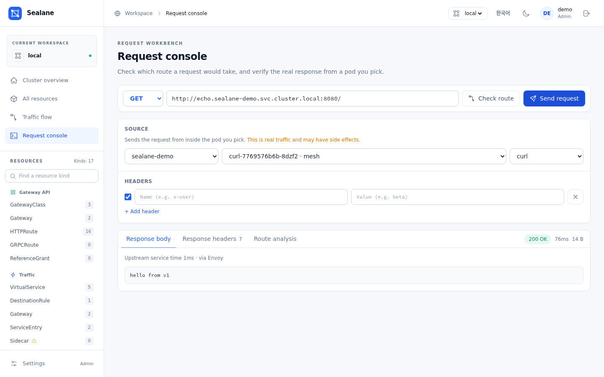
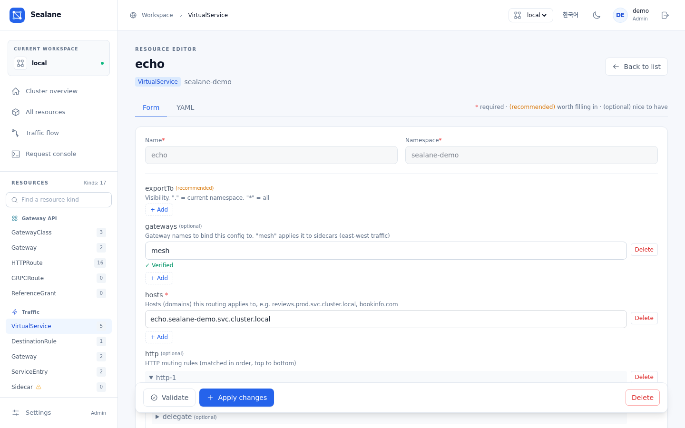

# Sealane

**English** | [Korean](README.ko.md)


[](https://github.com/wonjune95/sealane/actions/workflows/ci.yml)
[](https://github.com/wonjune95/sealane/actions/workflows/e2e.yml)
[](https://scorecard.dev/viewer/?uri=github.com/wonjune95/sealane)
[](https://artifacthub.io/packages/search?repo=sealane)

> Sealane is a third-party tool for Istio. It is not an official Istio or CNCF project and is not affiliated with or endorsed by them.

**Sealane is a routing console for Istio and Gateway API.** It is a single-binary web UI that lets you browse, create and edit `VirtualService`, `HTTPRoute`, `DestinationRule`, `Gateway`, `AuthorizationPolicy` and the rest of the Istio and Gateway API resources through schema-driven forms or YAML, with dry-run validation, diff preview and role-based accounts, and no CRDs or operators installed in your cluster.

```bash
# Helm (OCI)
helm install sealane oci://ghcr.io/wonjune95/charts/sealane --version 1.14.1 -n sealane --create-namespace
# or plain manifests
kubectl apply -f https://github.com/wonjune95/sealane/releases/latest/download/install.yaml
kubectl -n sealane port-forward svc/sealane 8080:8080   # → http://localhost:8080, log in as admin / admin
```

`install.yaml` expects the `istio-system` namespace for the istiod version reader; without Istio, the two `namespaces "istio-system" not found` errors from `kubectl apply` are harmless. A Helm install works without Istio: when the `istioNamespace` namespace is absent, the chart skips its istiod-reader Role (GitOps tools render with `helm template` and cannot detect this — set `istioNamespace: ""` there) — see [Getting started](https://wonjune95.github.io/sealane/getting-started/).



> Upgrading from **Istio Dashboard** (the project's previous name)? See [docs/upgrading.md](docs/upgrading.md) — your accounts and clusters carry over.

---

## TL;DR

- **Local accounts and roles** — users live in one ConfigMap (`user: "role:bcryptHash"`); login issues an HMAC-signed session cookie. Cluster calls run as the pod's ServiceAccount; the app role (`admin` / `editor` / `viewer`) decides who may change what. A first boot creates `admin`/`admin` and forces a password change.
- **Single sign-on (optional)** — OpenID Connect login (Keycloak, Dex, Google, ...) with IdP groups mapped to the same roles; local accounts keep working.
- **Writes are guarded** — every write is dry-run validated, previewed as a `kubectl diff`-style change, and checked against `resourceVersion` so a 409 shows *your copy vs the server's*. High-risk kinds require typing the resource name. Every change made through the UI lands in the change history with the account name.
- **Stateless, air-gapped** — React is embedded in the Go binary; sessions are signed cookies, so N replicas scale horizontally and nothing is fetched from the internet at runtime.
- **Generic resource engine** — dynamic-client based; 12 Istio kinds and 7 Gateway API kinds share one CRUD pipeline, and only CRDs present in the cluster are shown.
- **Traffic flow map** — draws ingress/egress paths from routing config alone; broken paths (missing service, zero endpoints) show as red edges.
- **Request console** — *Check route* computes which rule a request would hit without sending traffic; *Send* (opt-in, admin only) runs the request from inside a pod you pick so you see the real sidecar behavior.
- **Multi-cluster** — paste a kubeconfig to register a remote cluster; credentials stay in the host cluster's Secret and nothing is installed on targets.
- **English UI with a Korean locale** — switch from the header.

---

## Why this exists

A single typo in a `VirtualService` can take down an entire service. Yet the usual options are raw YAML with `kubectl apply` (no protection against human error) or observability-focused tools like Kiali (weak at editing configuration). This project fills the gap in between: **a console for safely editing configuration**.

One constraint drove the design — **"it must work just by deploying it."** No extra CRDs or operators on the cluster; it reads and renders existing resources the moment it connects. Kubernetes is the single source of truth and Sealane itself holds no state.

---

## Screenshots

The traffic flow map draws ingress and egress paths from routing configuration alone and marks broken ones in red.



The request console shows which rule a request would hit, or sends it for real from inside a pod you pick.



Resources are edited through forms generated from the CRD schema, kept in sync with a YAML view.



Admins manage accounts and remote clusters from the settings page.


---

## Documentation

Full documentation: **https://wonjune95.github.io/sealane/**

- [Getting started](https://wonjune95.github.io/sealane/getting-started/) — install, expose, first login, accounts
- [Authentication](https://wonjune95.github.io/sealane/authentication/) — local accounts and OIDC single sign-on
- [Architecture & security model](https://wonjune95.github.io/sealane/architecture/) — request flow, design decisions, permission model
- [Features](https://wonjune95.github.io/sealane/features/) — resource engine, write safeguards, flow map, request console
- [Configuration](https://wonjune95.github.io/sealane/configuration/) — flags, environment variables, Helm values
- [FAQ](https://wonjune95.github.io/sealane/faq/)
- [Versioning & support](https://wonjune95.github.io/sealane/versioning/) · [Governance & adopters](https://wonjune95.github.io/sealane/governance/) — stability promise, support, how the project is run

## Development

```bash
go run ./cmd/server --dev          # backend :8080, local kubeconfig (refuses to boot in-cluster)
cd web && npm run dev              # frontend HMR: Vite :5173 → /api proxy → :8080

go test ./internal/...             # unit tests
go vet ./cmd/... ./internal/...
./hack/check-i18n.sh               # no Korean outside locale files, en/ko keys match
helm lint charts/sealane
cd web && npm run lint && npm run test:cluster-selection && npm run test:flow-map && npm run test:login-sso
./hack/e2e.sh http://localhost:8080   # API smoke test against a fresh install (admin/admin)
```

See [CONTRIBUTING.md](CONTRIBUTING.md) and the [contributing page](https://wonjune95.github.io/sealane/contributing/) for the full checklist and how to build the docs.

## Compatibility

Tested in CI on kind with Istio 1.31.1 and Gateway API v1.5.1 (linux/amd64); the image is multi-arch (amd64/arm64).
Kubernetes 1.28+ is required; the full matrix is in [docs/compatibility.md](docs/compatibility.md).

## License

[MIT](LICENSE)
