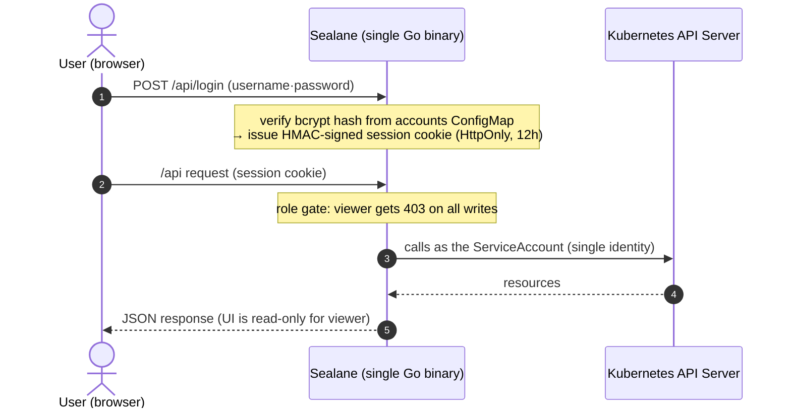

# Architecture & security model

- **Local accounts = ConfigMap** — one key in the `sealane-accounts` ConfigMap is one account (`username: "role:bcryptHash"`). Stored in the cluster (etcd), not the pod, so **accounts survive restarts and redeploys**; Helm doesn't manage this CM so upgrades keep it. Changes propagate through the mounted volume **within ~1 minute, no restart**.
- **Single sign-on (optional)** — with `oidc.enabled=true`, the login page also offers an OpenID Connect button. The IdP's groups map to the same three roles and the result is the same signed session cookie, so everything after login is identical to a local account. See [Authentication](authentication.md#single-sign-on-oidc).
- **Account management UI** — admins can add accounts, change roles/passwords, and delete accounts from the settings page (`GET/PUT/DELETE /api/accounts`; the server patches the CM). Self-deletion, self role-change, and deleting the `admin` account are blocked to prevent lockout. `kubectl edit` works too.
- **Initial admin + forced change** — if the accounts ConfigMap has no `admin` key at boot, `admin`/`admin` is created. Logging in with the initial password **locks the UI to a password-change screen** until you change it.
- **Three roles** — `viewer` (read-only) · `editor` (can write) · `admin`. The server gates every mutating request by role (403) and the UI disables buttons using the same information.
- **Change your own password** — user chip in the header → settings page, after verifying the current password (viewers included). The server patches only your own CM key.
- **Multi-cluster** — remote-cluster kubeconfigs are stored in the `sealane-clusters` Secret (key = cluster name). Register/delete is admin-only (`PUT/DELETE /api/clusters/{name}`, with a connectivity test on register), and the settings page shows each cluster's **connection status and version**. Every API takes a `?cluster=` parameter (default `local`). The CRD catalog and schema caches are per-cluster, so clusters with different CRDs installed are handled safely. See [Multi-cluster](multi-cluster.md).
- **One snapshot per request** — the flow map, route check, analysis and service view read one concurrent snapshot per request: each cluster-wide list (Services, Endpoints, the routing kinds, and Pods for the analysis) runs once and in parallel, so a page costs about one API round trip rather than one per list or per backend Service. The service view adds its own Service GET and the namespace security-policy lists, which run concurrently alongside the snapshot.
- **Sessions are signed cookies** — no server store, stateless HA intact. Without `SESSION_SECRET` a random per-boot key is used (restart = re-login).
- **Hardening** — security headers including CSP (`default-src 'self'`), HttpOnly cookies, distroless non-root image, readOnlyRootFilesystem.
- **Air-gapped** — the frontend bundle is inlined into the binary. Zero runtime external dependencies.

## Design decisions

### Why a generic engine instead of per-kind structures

The initial design had dedicated providers for `HTTPRoute`/`VirtualService`. But Istio + Gateway API span ~20 kinds with evolving CRD versions; per-kind models scale maintenance linearly and break on version changes. → Switched to **dynamic client + auto-generated forms from CRD OpenAPI schemas**: adding a kind is one registry line, and schema changes are absorbed automatically. Curated forms can still be layered on for a few kinds that need them.

### Why app-local accounts instead of token passthrough

The first implementation passed the user's Kubernetes bearer token through, authorizing with cluster RBAC — accurate, but issuing/delivering/renewing tokens per user was operationally painful and login UX was poor. → Switched to **app-local accounts (ConfigMap) + roles**, with all cluster operations under a single SA identity. The downside (K8s audit logs show the SA, not the user) is offset by Sealane's own change history recording account names. If per-user K8s RBAC parity becomes necessary, this can be extended with Impersonation.

Single sign-on keeps this model: an OIDC login produces an app role from the user's IdP groups, and cluster calls still run as the ServiceAccount.

### Why no real-time SSE streams

The design stage considered per-user watch → SSE live sync. But keeping the server stateless for HA means opening a watch per connection — replicas × concurrent users watch connections against the API server. For an internal ops tool (tens of concurrent users, low change frequency) that cost wasn't justified. → Kept the server stateless and converged on the **in-memory change history** (30s refresh) plus manual refresh. *A deliberate trade: "unbreakable stateless HA" over "nice-to-have real-time".*

### Why the `--dev` boot guardrail

`--dev` skips login and uses a local kubeconfig — convenient locally, an auth bypass if it ever runs in production. So when `KUBERNETES_SERVICE_HOST` (injected into every pod) is detected together with `--dev`, the process **exits immediately** (inducing CrashLoopBackOff). Accidentally shipping dev mode to a cluster is structurally impossible.

## Permission model

Permissions come in two separate layers — cluster permissions and user permissions:

| Layer | Owner | Scope |
|---|---|---|
| Cluster (K8s RBAC) | pod ServiceAccount | CRUD on managed CRDs (`*.networking.istio.io`, `security/telemetry.istio.io`, `*.gateway.networking.k8s.io`) + read namespaces/services/endpoints/pods + patch accounts CM / clusters Secret. Configured by Helm. |
| User (app roles) | accounts ConfigMap, or IdP groups for SSO users | `admin` = write + account/cluster management, `editor` = write, `viewer` = read-only. The server gates every mutating request (403). |

Account management: admins use the **account management UI** on the settings page, or edit the `sealane-accounts` ConfigMap directly (add key = add account, edit role string = change role, delete key = delete account). Local users change their own password on the settings page; SSO users manage their password at the identity provider.
