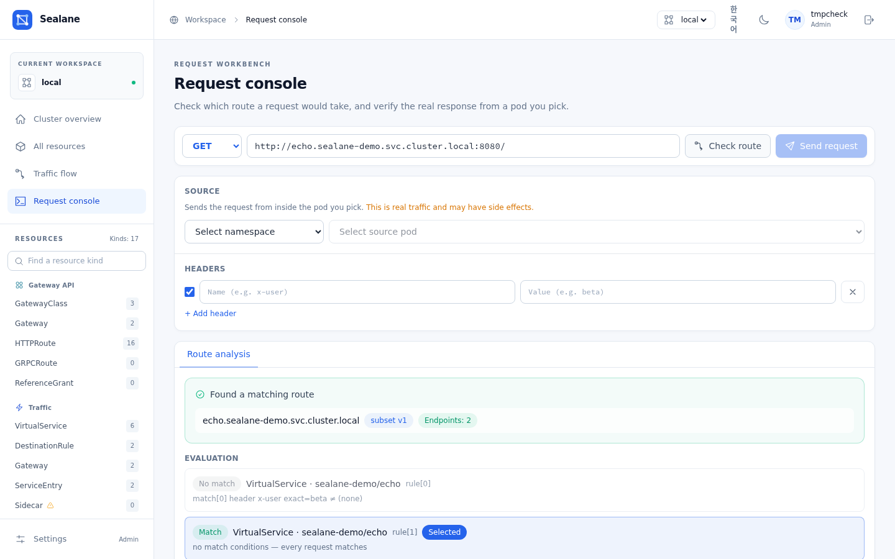

# Features

## Generic resource engine
A single CRUD path (`/api/resources/{type}`) built on the dynamic client (unstructured) covers everything below. Only CRDs actually installed on the cluster are exposed (`/api/capabilities`, `/api/resourceTypes`).

| Category | Kinds |
|---|---|
| **Traffic** (Istio) | VirtualService · DestinationRule · Gateway · ServiceEntry · Sidecar · WorkloadEntry · WorkloadGroup · EnvoyFilter |
| **Security** (Istio) | AuthorizationPolicy · PeerAuthentication · RequestAuthentication |
| **Telemetry** (Istio) | Telemetry |
| **Gateway API** | GatewayClass · Gateway · HTTPRoute · GRPCRoute · TCPRoute · TLSRoute · ReferenceGrant |

**Status in lists** — resource lists show a status pill. Gateway API kinds read their conditions (`Accepted`, `ResolvedRefs`, `Programmed`; for routes, the conditions under `status.parents`): any of them `False` shows an error with its reason. Istio kinds read `status.validationMessages` (worst level wins, with the message code); istiod writes those only when its analysis is enabled (`PILOT_ENABLE_ANALYSIS=true`), otherwise Istio kinds show no pill.

## Multiple write safeguards
1. **Dry-run first** — `DryRun=All` catches admission-webhook and schema errors before saving.
2. **Diff preview** — line-level diff between the current and proposed object, `kubectl diff`-style.
3. **409 conflict control** — on `resourceVersion` mismatch, never blindly overwrite; show *my edit vs server latest* and let the user decide.
4. **High-risk confirmation** — kinds with a large blast radius require typing the resource name to delete/update.
5. **Owner warning** — resources that Argo CD, Flux or Helm manage carry a badge with the tool name in the resource list, and the editor warns before you change one: Argo CD and Flux revert the edit on their next sync (or report the resource out of sync), and the next `helm upgrade` overwrites it. Editing is not blocked, so an emergency fix still works; change the source afterwards. Detection reads the owner's metadata: Argo CD's `argocd.argoproj.io/tracking-id` annotation (annotation tracking, the default since Argo CD 3.0) or an `argocd.argoproj.io/instance` label, Flux's `kustomize.toolkit.fluxcd.io/name` and `helm.toolkit.fluxcd.io/name` labels, and the `meta.helm.sh/release-name` annotation that `helm install`/`upgrade` writes. Argo CD's older label tracking on `app.kubernetes.io/instance` is not detected, because Helm charts set the same label; manifests rendered with `helm template` and applied by hand (such as `install.yaml`) are not flagged either, since nothing upgrades them.

## Traffic flow map
Draws the traffic path purely from routing configuration — no metrics dependency, so it works on any cluster immediately.

- **Ingress** — External → Gateway → Route (hosts) → Service (endpoint counts). Backends that don't exist or have zero endpoints get red dashed edges and a red badge, so dead-end configs are caught at a glance.
- **Egress** — Mesh → egress Gateway → external hosts; ServiceEntries not referenced by any route are shown as direct egress paths. The tooltip and details panel name the ServiceEntry that covers an external backend (wildcard host matching included).
- **Graph** — drawn like Kiali's service graph: one dashed box per namespace, small shaped nodes (rounded square = gateway, diamond = route, circle = service, dashed circle = external host) with the kind icon inside and the name and host or endpoint count below, arrowed edges from left to right, a red badge on nodes that need attention, and a legend under the graph. Stages flow source → gateways → routes → destinations, each namespace keeping its own band so boxes never overlap.
- **Navigation** — switch between ingress and egress, search by name/host/kind, filter by namespace or problem paths. Matching nodes retain their upstream and downstream connections. Missing gateway references appear as warning nodes.
- **Interaction** — select a node with a click or keyboard to highlight its paths and dim the rest. The details panel shows its status, hosts, port and resource link. Mouse drag, zoom, fit and layout reset are available.
- **Refresh** — configuration refreshes every 30 seconds, with a manual refresh button. Failed queries show an error and retry action. Animated connections do not represent actual traffic volume or latency.

## Request console — route check (simulator)
Compose a request Postman-style (method, URL, headers, body) and verify it two ways. **Route check** computes which rule the request matches and where it goes — **without sending any request**. No traffic, no side effects, and no extra permissions (viewers can use it).

- **Shows the evaluation** — not just the winning rule, but **every rule that did not match and why** (which condition failed). That answers "why didn't it take this rule?" directly.
- **Verifies the destination** — service existence and endpoint count, plus whether the `subset` is actually defined in a DestinationRule (a typo there silently blackholes traffic).
- **Checks the port** — the destination's `port.number`, else the request URL's port (80 for http, 443 for https), must be one the Service exposes; otherwise the result flags it in red, because Envoy would answer `503`. A destination without a port on a single-port Service uses that port, as Istio does, for any VirtualService whose request host is not the Service itself (a request addressed to the Service is checked against its own port).
- **Service picker** — pick a namespace and a Service (and a port when it has several) to fill the URL with `http://<name>.<ns>.svc.cluster.local:<port>/`; typing a URL by hand still works.
- **Models precedence correctly** — Istio takes the first match in declaration order; Gateway API follows the spec (path type → path length → method → header count). PathPrefix segment boundaries are respected (`/api` does not match `/apifoo`).

## Send a real request (opt-in)
The same request can be **sent from inside a pod you pick under Source**. It goes through that pod's sidecar, so routing, authorization and mTLS are exercised for real — not "this is how it should route" but "this is how it routed".

- **Responses read in Istio terms** — `403` + `RBAC: access denied` → denied by an AuthorizationPolicy; `503` + `upstream connect error` → mTLS mismatch or no healthy endpoint; `503` from `server: envoy` with no upstream service time → no cluster for that host and port (empty body) or no healthy endpoints (`no healthy upstream`); presence of Envoy headers → whether the sidecar was actually traversed. Upstream service time (`x-envoy-upstream-service-time`) is shown alongside.
- **Three locks** — (1) Helm opt-in (`requestTester.enabled=true`, off by default), (2) admin only, (3) argv built without a shell, plus input validation (scheme, method, header newlines) and timeout/response-size caps. Every test request is audit-logged with user, source pod and target URL.
- **The cost of enabling it** — the ServiceAccount gains `pods/exec` create (it already reads pods), which is effectively arbitrary command execution in any pod. That's why it ships off. If the target container has no `curl` (distroless), the UI says so.

To try it, apply [`examples/demo-mesh.yaml`](https://github.com/wonjune95/sealane/blob/main/examples/demo-mesh.yaml) (`kubectl apply -f examples/demo-mesh.yaml`). It brings up sidecar-injected `echo` v1/v2, a curl client and an ingress Gateway route for the flow map, so you can watch the `x-user: beta` canary split both ways (clean up with `kubectl delete namespace sealane-demo`).

## Mesh analysis
**Mesh analysis** (`/analysis`, API `/api/analyze?ns=`) runs cross-resource checks that explain why traffic would not flow. It reads configuration, Endpoints and pod labels (no metrics or traffic), refreshes every 30 seconds and filters by namespace (references are still resolved cluster-wide).

| Code | Severity | On | When |
|---|---|---|---|
| `vs-host-missing` | error | VirtualService | a route destination resolves to an in-cluster Service that does not exist |
| `vs-subset-undefined` | error | VirtualService | a destination names a subset no DestinationRule defines for that Service |
| `vs-port-not-exposed` | error | VirtualService | a destination's `port.number` is not a port of the Service (Envoy answers 503) |
| `vs-gateway-missing` | error | VirtualService | `spec.gateways` names an Istio Gateway that does not exist (`mesh` ignored) |
| `vs-host-conflict` | warning | VirtualService | another VirtualService bound to the same gateway claims the same host |
| `backend-no-endpoints` | warning | VirtualService / HTTPRoute | the backend Service exists but has zero ready endpoints (ExternalName Services are exempt) |
| `httproute-backend-missing` | error | HTTPRoute | a `backendRefs` Service does not exist |
| `httproute-port-not-exposed` | error | HTTPRoute | a `backendRefs` port is not a port of the Service (the route still shows `ResolvedRefs=True`; Envoy answers 503) |
| `httproute-not-accepted` | error | HTTPRoute | a parent condition `Accepted` or `ResolvedRefs` is `False` |
| `gateway-not-programmed` | error | Gateway (API) | condition `Accepted` or `Programmed` is `False` |
| `dr-host-missing` | warning | DestinationRule | `spec.host` resolves in-cluster but the Service is missing and no ServiceEntry covers it |
| `dr-subset-no-pods` | warning | DestinationRule | Service selector + subset labels match no pod in the Service's namespace |
| `gateway-selector-no-pods` | warning | Gateway (Istio) | `spec.selector` matches no pod in any namespace |
| `namespace-injection-no-sidecar` | warning | Namespace | the namespace has `istio-injection=enabled`, or an `istio.io/rev` label and no `istio-injection` label (any other `istio-injection` value turns injection off, as in Istio's webhook), yet a `Running` pod has no `istio-proxy` container and does not opt out (`sidecar.istio.io/inject: "false"` label or annotation); native sidecars (an `istio-proxy` init container, Istio 1.22+ with `ENABLE_NATIVE_SIDECARS`) count as sidecars |

Every finding carries a one-line remediation hint under its message (what to create, fix or restart).

The three pod checks need `pods` list (in the chart's ClusterRole from 1.1.0). Without it they are skipped and the page says so (`"skipped": ["pods"]`); only pod labels, container names, phase and the injection opt-out are read. The sidecar check also needs `namespaces` list and is skipped silently without it; with `?ns=` it reports the namespace of that name. If Services cannot be listed, the existence checks are skipped; a kind whose CRD is not installed is skipped silently.

The Services list can be narrowed to services that have any routes, destination rules, policies or findings ("Only services with mesh config").

Opening a finding's resource link lands on the YAML tab with the offending field highlighted and named in a banner (`?focus=` carries the path, for example `spec.http[1].route[0].destination.subset`).

## Service view
**Services** (`/services`, then one Service) shows everything that applies to a Service (API `/api/services/{ns}/{name}/mesh`): its selector, ports and ready endpoints; VirtualServices whose hosts name it or that route to it (a bare `*` host never counts); DestinationRules for its host, wildcards included; HTTPRoutes with it as a backend; the gateways those routes bind; the security policies (AuthorizationPolicy, PeerAuthentication, RequestAuthentication) that apply; and the analysis findings that concern it or any resource listed on the page (for example a bound Gateway whose selector matches no pod). The Services list itself shows per-Service counts of routes (VirtualServices for its host plus HTTPRoutes to it), destination rules, policies and findings, computed by the same rules (API `/api/services?mesh=true`).

Admins and editors get create buttons on the Service page — **New VirtualService for this service**, **New DestinationRule for this service** (when the Istio CRDs are installed) and **New HTTPRoute for this service** (when the Gateway API CRDs are) — that open the editor with the template already pointed at the Service (namespace, name, host or backendRef, and the Service port filled in).

Policies are marked by scope: **workload** (the policy selector matches the Service selector, or a `targetRef` names the Service), **namespace** (no selector, same namespace) or **mesh** (no selector, in the Istio namespace: `istioNamespace`, default `istio-system`). Workload scope is a heuristic: it compares the policy selector with the Service selector, not with pod labels, so a policy that selects pods by a label the Service selector lacks is not shown.

## Role-aware UI + change history
- The UI checks the signed-in user's role up front (local account or SSO): for viewers, forms and apply/delete buttons turn **read-only**. The server enforces the same rule (403), so the UI can't be bypassed.
- Sign-in: local accounts (throttled after repeated failures) and optional SSO, whose `login` log line records the IdP groups; `oidc.hideLocalLogin` leaves only the SSO button. Local accounts live in the `sealane-accounts` ConfigMap (rendered empty by the chart and install.yaml, filled by Sealane and the UI, or seeded from the `accounts` value); single sign-on settings live in `sealane-cm`, rendered from the `oidc.*` values or edited directly like Argo CD's `argocd-cm`. See [Authentication](authentication.md).
- The home page's **change history** panel records create/update/delete operations made through Sealane with account and timestamp. It is kept in the cluster (see [Change history and restore](#change-history-and-restore)), so every replica shows the same list and it survives restarts. Home cards also show the actual istiod control-plane version (e.g. `1.30.2`).

## Change history and restore
- Every create, update and delete made through Sealane is stored with the object **before and after** the change, in two ConfigMaps next to Sealane: `sealane-history` lists the last 200 changes, `sealane-history-objects` keeps their objects up to about 768 KiB and drops the oldest first. Sealane creates both on the first change; replicas share them.
- The editor's **History** tab lists the changes made to that resource. **Compare with current** shows a diff between the live object and the version a change left behind; **Load into editor** puts that version in the editor with the current `resourceVersion`. Nothing changes until you press Apply, which runs the usual dry-run, diff preview and conflict check, so restoring is an ordinary, reviewable update.
- A deleted resource shows **Restore** in the home page's change history: it opens the new-resource editor with the object as it was before the deletion.
- Viewers can compare versions but not load them. Changes made outside Sealane (kubectl, Argo CD, Flux) are not recorded, and for resources a GitOps tool manages the [owner warning](#multiple-write-safeguards) still applies: restore in Git instead.

## Schema-driven forms + YAML dual editing
- `react-jsonschema-form` reads the CRD OpenAPI schema and generates input forms — safe editing without knowing YAML.
- **Required/recommended markers** — every field gets a `*` (required) · `(recommended)` · `(optional)` badge. On top of the CRD schema's `required`, a curated list compensates for Istio schemas not declaring top-level requireds (VS `hosts`, DR `host`, Gateway `selector`/`servers`, SE `hosts`/`ports`).
- **Reference-resolving forms** — `host`/`backendRefs` suggest Services, `subset` suggests DestinationRule subsets, `gateways`/`parentRefs` suggest Gateways from the live cluster, with existence badges (✓/⚠) and jump links. Free-text is preserved so external hosts and cross-namespace references still work.
- **Curated forms** — three kinds get a hand-built form instead of the generated one, each covering a fixed subset:
    - **VirtualService** — hosts, gateways and HTTP rules: name, URI and header matches (exact, prefix or regex), destinations (host, subset, port) with weights, timeout, retries (attempts, per-try timeout) and URI rewrite. Subset suggestions follow each destination's host.
    - **DestinationRule** — host, subsets selected by labels, and the top-level TLS mode and simple load balancer.
    - **HTTPRoute** — parentRefs, hostnames and rules with one path match (PathPrefix or Exact) and weighted Service backends.

    VirtualService and DestinationRule keep `exportTo` as is. Anything outside the subset (for example a VirtualService `fault` or `tcp` routes, a DestinationRule `connectionPool` or per-subset policy) locks the Form tab.
- Form ↔ YAML stay in sync. If an object uses advanced fields the form can't express, the Form tab locks with a "YAML only" notice → no field loss.

## UI
**Workspace navigation** — the sidebar lists the main screens (cluster overview, all resources, traffic flow, mesh analysis, services, request console) and the installed resource kinds grouped by category. A **single search box** narrows a long list of kinds, and each one carries its count.

- **Cluster switcher** — the header button shows the selected cluster with a connection dot and opens a menu of registered clusters (the current one checked) with a shortcut to cluster management for admins. The menu works with the keyboard (arrow keys, Home/End, Enter, Escape).
- **Language** — English and Korean UI (header toggle). Sealane's own server errors (sign-in, accounts, clusters, conflicts, role checks) carry a stable `code` in the error envelope and are shown in the active language; Kubernetes validation messages stay as the API server returns them.
- **Home shortcuts** — cards for traffic flow, the request console, mesh analysis (with current error and warning counts; amber with a warning icon while there are findings) and services.
- **Lists** — every managed kind shows a one-line summary (hosts, DestinationRule host, AuthorizationPolicy action, mTLS mode, listeners, parent count, …). Resource lists sort by Namespace, Name, Summary (status pill first) and Age; Services by Namespace and Name; all resources by Kind, Namespace, Name and Age. Clicking a header again reverses it; until a header is clicked, rows keep the order the API returned. Lists show 50 rows, with "Show more" adding 50 at a time.
- **Light/dark** — the theme syncs across tabs and carries into the YAML editor. The accent color lives in one CSS variable (`--accent`), so a one-line change reskins the app.
- **Responsive** — no horizontal scrolling down to 320px; navigation collapses into a drawer on narrow screens.
- **Accessibility** — confirm dialogs trap keyboard focus and close on Escape. High-risk resources still require typing the name to proceed.
- The YAML editor shows indent guides so indentation mistakes are visible.

