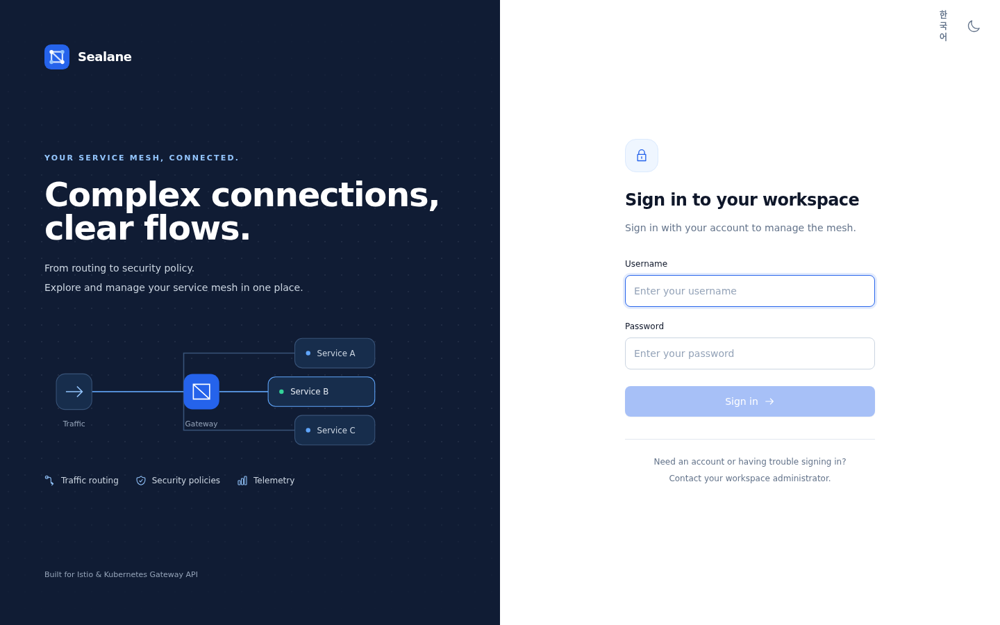
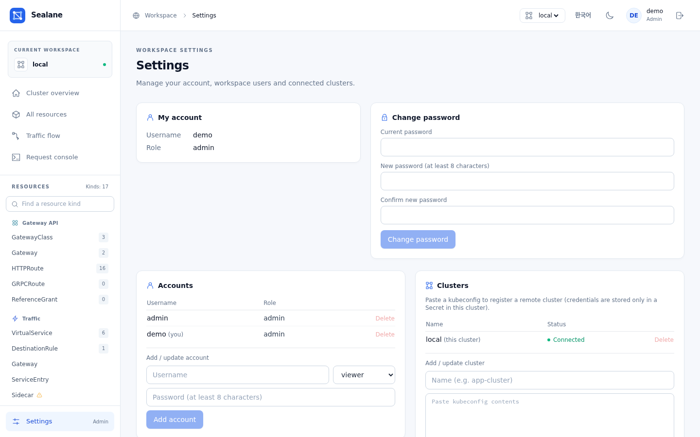

# Getting started

Running in-cluster is the default. To install the prebuilt image you only need Helm (or `kubectl`):

```bash
# Helm (OCI)
helm install sealane oci://ghcr.io/wonjune95/charts/sealane --version 0.10.0 -n sealane --create-namespace
# or plain manifests
kubectl apply -f https://github.com/wonjune95/sealane/releases/latest/download/install.yaml
kubectl -n sealane port-forward svc/sealane 8080:8080   # → http://localhost:8080, log in as admin / admin
```

!!! note "Clusters without Istio"
    `install.yaml` expects the `istio-system` namespace for the istiod version reader; without Istio, the two `namespaces "istio-system" not found` errors from `kubectl apply` are harmless. Helm users whose istiod lives elsewhere set `istioNamespace`.

    For a Helm install on a cluster without Istio, set `istioNamespace` to a namespace that exists (for example `--set istioNamespace=sealane`): the chart creates its istiod-reader Role and RoleBinding in that namespace, so it must exist. The home page then simply shows no control-plane version.

The steps below are for building and installing from a clone. You only need Docker and Helm (the image build is multi-stage — no local Go/Node required).

## 1) Image

Every release tag (`v*`) publishes an image via GitHub Actions — use it directly:

```bash
# prebuilt image (recommended)
ghcr.io/wonjune95/sealane:0.10.0     # or :latest
```

Or build your own:

```bash
docker build -t <registry>/sealane:<tag> .
docker push <registry>/sealane:<tag>
```

## 2) Helm install

```bash
helm install sealane ./charts/sealane -n sealane --create-namespace \
  --set image.repository=<registry>/sealane --set image.tag=<tag>
```

The published image is multi-arch (amd64/arm64) and signed with cosign (keyless); see [Releasing](releasing.md) for the verification command.
Key values: `image.*`, `imagePullSecrets` (private registries), `replicaCount` (stateless — scale for HA), `accountsConfigMap`, `clustersSecret`, `requestTester.enabled` (real request tester — off by default; enabling it grants `pods/exec`), `sessionSecret.*` (stable session-signing key), `ingress.*`, `httpRoute.*` (expose via Ingress or Gateway API), `oidc.*` (single sign-on, see [Authentication](authentication.md#single-sign-on-oidc)). The full table is in [Configuration](configuration.md#helm-values). The pod runs distroless non-root (uid 65532) with readOnlyRootFilesystem.

## 3) Expose

Expose it to match your cluster:

```bash
# with Gateway API — adjust parentRefs/hostname first
kubectl apply -f examples/httproute.yaml

# with an Ingress controller — create an Ingress backed by service sealane:8080
```

The chart can also create either one for you: `httpRoute.enabled=true` (with `httpRoute.parentRefs` / `hostnames`) or `ingress.enabled=true` (with `ingress.className` / `hosts` / `tls`).

## 4) Log in

On first boot the initial account **`admin` / `admin`** is created. Logging in takes you straight to a password-change screen — you must change it before going any further.



## 5) Add accounts

As admin, use **settings → account management** to add accounts and change roles/passwords in the UI (self-delete, self role-change, and deleting `admin` are blocked). The store is still a ConfigMap, so kubectl works too:

```bash
go run ./hack/bcrypt-hash.go 'password'                      # generate bcrypt hash
# (without Go) htpasswd -bnBC 10 "" 'password' | tr -d ':\n'
kubectl -n sealane edit configmap sealane-accounts
# add to data:  username: "role:hash"   (role: admin | editor | viewer)
```

No restart needed — mounted-volume sync applies it within ~1 minute. See [`examples/accounts-configmap.yaml`](https://github.com/wonjune95/sealane/blob/main/examples/accounts-configmap.yaml).

To let people sign in with your identity provider instead, see [Single sign-on (OIDC)](authentication.md#single-sign-on-oidc).

## 6) Register more clusters (optional)

To manage multiple clusters from one Sealane install, go to **settings → cluster management** as admin and paste the target cluster's kubeconfig with a name. A connectivity test runs on registration, and the header dropdown switches clusters. Nothing is installed on target clusters; credentials live only in the `sealane-clusters` Secret next to Sealane. See [Multi-cluster](multi-cluster.md).



## After installing

① change the admin password (forced at first login) ② add accounts (settings → account management) or turn on single sign-on ③ for multi-cluster, register kubeconfigs (settings → cluster management).

Uninstall with `helm uninstall sealane -n sealane` (the accounts ConfigMap and clusters Secret survive — delete them too for a full cleanup).
